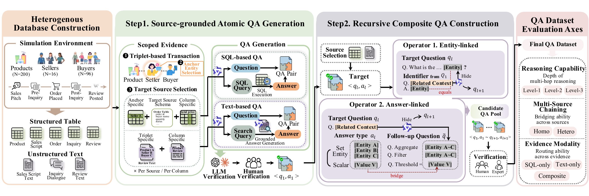
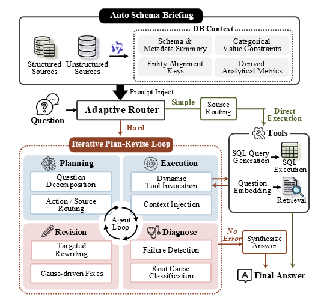

<div align="center">

# Toward Agentic Retrieval-Augmented Generation<br>for Enterprise Retail Workflows over Heterogeneous Data Sources

Jeonghwan Choi¹ &nbsp;·&nbsp; Jibin Hwang¹ &nbsp;·&nbsp; Hayoon Park¹ &nbsp;·&nbsp; Hyeonjae Cheon² &nbsp;·&nbsp; Hwanjun Song¹

<sub>¹ KAIST &nbsp;·&nbsp; ² GS Retail</sub>

[**Paper**](https://arxiv.org/abs/2610.25096) &nbsp;·&nbsp; [**Dataset**](https://huggingface.co/datasets/DISLab/RetailBridge) &nbsp;·&nbsp; [**Project page**](https://retailbridge-kdd.github.io)

**RetailBridge** — a multi-source question-answering benchmark for enterprise
retail, where evidence is deliberately scattered across structured tables and
free text, so answering a question means *bridging* sources rather than querying
one of them well.

**1,680 questions** &nbsp;·&nbsp; **3 evaluation axes** &nbsp;·&nbsp; **heterogeneous sources**

</div>



**RetailBridge** is the benchmark. Every gold answer was produced by executing a
query (or, for a composite question, a chain of SQL and retrieval calls) against
the database, so answers are grounded in the data. **RetailRAG** is the
retail-aware agentic RAG framework the paper proposes and evaluates on it. It
briefs itself on the schema, plans a query across sources, runs SQL and dense
retrieval, and repairs a step when it comes back wrong.

> [!TIP]
> This repository holds the RetailRAG framework and the evaluation script. The
> benchmark questions and the database are on Hugging Face at
> [`DISLab/RetailBridge`](https://huggingface.co/datasets/DISLab/RetailBridge), and
> `python scripts/download_data.py` fetches both. See [running RetailRAG](#running-retailrag).

---

## The benchmark

**1,680 questions** — 560 from each of three generation models — every one
labelled along three evaluation axes. Counts are **per generation model** and
identical across all three, so each cell is ×3 in the full 1,680:

| Axis | Field | Distribution (per model — sums to 560) |
|:--|:--|:--|
| **Level** — reasoning depth | `reasoning_level` | Level-1 **80** · Level-2 **240** · Level-3 **240** |
| **Source** — single vs. multiple sources | `source_chaining` | Homo (single source) **240** · Hetero (multiple) **320** (2 sources 240, 3 sources 80) |
| **Modality** — evidence type | `evidence_modality` | SQL-only **200** · Text-only **200** · Composite **160** |

Level-1 is the smallest slice on purpose — single-source questions are the easy
case, and the benchmark targets what happens when one source is not enough.

### Example questions

Three questions from the benchmark, one per level.

> **Level-1 · SQL · Homo** &nbsp; *What is the total revenue for Michael K.?*
> → **\$11,296.83**
>
> **Level-2 · Composite · Hetero** &nbsp; *What is the flat-rate shipping cost for Crystal T.'s highest net revenue product?*
> → **\$7.13 per order** &nbsp;<sub>SQL finds the top-revenue product; text reads its shipping fee.</sub>
>
> **Level-3 · Composite · Hetero** &nbsp; *In her product review, why did Lisa J. decide to return the refunded product she ordered at the highest total price?*
> → *"She returned it because she realized her actual need for the projector was minimal after purchase and it simply didn't fit into her lifestyle as expected."*

### Record format

Each question record holds `id`, `question`, `answer`, the three axis labels
(`reasoning_level`, `source_chaining` as `Homo` or `Hetero`, `evidence_modality`),
the gold evidence `sources` in hop order, `composite_family`, `operation_type` and
`generator`. The full field reference is on the
[dataset card](https://huggingface.co/datasets/DISLab/RetailBridge).

---

## The database

A persona-driven retail world — **16 sellers, 96 buyers, 200 products** — kept
small and dense so that a single seller or buyer accumulates enough orders,
broadcasts, reviews and inquiries for multi-hop questions to reach. The same
commercial episode is split across **eight heterogeneous sources**:

| | Sources |
|:--|:--|
| **Structured (SQL)** | Product · Order · Script (broadcasts) · Review · Inquiry |
| **Unstructured (text)** | sales-script transcripts · review bodies · inquiry threads |

The evaluation database holds two things back from the agent, so it cannot
shortcut a multi-source question. First, the metric store (the paper's `D_metric`,
pre-computed KPI tables such as `Seller_Metric` and `Buyer_Metric`) is not
included, so the agent must recompute KPIs like refund rate from the base tables. Second, the free-text columns that mirror the text stores
(inquiry `dialogue`, review bodies, broadcast transcripts) are dropped from the
SQL tables, so narrative evidence has to be reached through dense retrieval.

The database is part of the Hugging Face release. Its `database/raw/` folder holds
the five SQLite tables and the three text stores in the form RetailRAG reads, and
the dataset viewer shows every table without downloading.

---

## Running RetailRAG

RetailRAG composes a schema briefing once, plans a query across sources, runs SQL
and dense retrieval, and repairs a failed step without restarting the chain.

<p align="center"></p>

```bash
pip install -r requirements.txt
python scripts/download_data.py            # questions + database into data/RetailBridge/
export OPENROUTER_API_KEY=...              # see .env.example
python scripts/build_vector_index.py       # one-time: embeds the three text stores into data/index/

# smoke test: a few questions confirm the agent, databases and scoring wire up
python evaluate.py --limit 5 --out results/smoke.json

# full run on all 1,680 questions
python evaluate.py --llm-judge --parallel 8 --out results/retailrag.json
```

Each answer is scored against the gold answer, and `--llm-judge` adds a binary LLM
judge **held fixed on one model** so cross-model comparisons stay calibrated.
Choose the agent backbone with `--model` and its output budget with `--max-tokens`
(default 8192, reasoning included). Results aggregate overall, per **Level**, and
per **Modality**, written incrementally to `--out`, with a `summary` block at the
end.

> The schema briefing is written once per run by the backbone, checked against the
> real schema (store and column names), and cached next to the index, so every
> worker answers with the same briefing.
>
> The index step embeds ~43k documents with `Qwen3-Embedding-8B` through
> OpenRouter and writes about 0.8 GB to `data/index/`. It runs once; later runs
> reuse the files.

---

## Results

**How far can current LLMs get on RetailBridge?** Ten backbones evaluated under
RetailRAG on the full 1,680-question benchmark (all with `Qwen3-Embedding-8B`
dense retrieval, top-10). The score is **LLM-as-judge** accuracy (`Qwen3.6-Plus`)
over all 1,680 questions; **API/query** is the mean LLM calls per question.

| Backbone | Type | LLM-judge | API/query |
|:--|:--:|:--:|:--:|
| Qwen3.6-Plus | prop. | **0.511** | 6.92 |
| GPT-5.4 | prop. | 0.508 | 7.28 |
| Gemma-4-31B-IT | open | 0.498 | 10.50 |
| DeepSeek-V4-Pro | open | 0.466 | 9.68 |
| DeepSeek-V4-Flash | open | 0.449 | 8.88 |
| GPT-oss-120B | open | 0.429 | 7.45 |
| Qwen3.6-Flash | prop. | 0.390 | 7.32 |
| Gemini-3.1-Flash | prop. | 0.358 | 9.72 |
| Kimi-K2.5 | open | 0.255 | 11.81 |
| Qwen3.6-35B-A3B | open | 0.236 | 12.76 |

Even the strongest backbones clear only **about half** the benchmark
(Qwen3.6-Plus 0.511, GPT-5.4 0.508), a small open model nearly matches them
(Gemma-4-31B-IT 0.498), and every model drops sharply from Level-1 to Level-3
— **RetailBridge stays unsolved for frontier LLMs.** Per-level,
per-source numbers are Table 4 in the paper.

<details>
<summary>RetailRAG vs. six RAG baselines (fixed <code>gpt-oss-120b</code> backbone)</summary>

Holding the backbone fixed, RetailRAG's retail-specific design (schema briefing,
source-routed planning, plan revision) beats every prior RAG system on the same
benchmark:

| | Method | LLM-judge |
|:--|:--|:--:|
| *Naive* | Text-to-SQL | 0.182 |
| | Dense RAG | 0.115 |
| *Agentic* | ReAct | 0.085 |
| | MAC-SQL | 0.201 |
| | TableRAG | 0.185 |
| | HetaRAG | 0.293 |
| **Ours** | **RetailRAG** | **0.429** |
</details>

---

## How the benchmark was built

Every question is executable by construction: its gold answer is produced by
running a query against the database, and every candidate passes deterministic
checks plus two validator models before entering the set. Questions are built
in three stages — single-source atomics, typed composition into multi-hop
chains, and balanced sampling across the three axes.

<details>
<summary>Stages, composition operators, validation</summary>

**Stage 1 — atomic (Level-1).** Sample a `(seller, buyer, product)` triplet, pick one piece of evidence from a source it touches (a
table cell for SQL, a self-contained snippet for text), and have a model write a
single-source question together with the one SQL query or dense-retrieval call
that answers it. The query is executed immediately, so its result *is* the gold
answer.

**Stage 2 — composite (Level-2/3).** Atomics are chained, legal only when the
second hop needs the first hop's output (enforced at the type level — each hop is
typed by what it returns, and only permitted transitions compose). The same
typed rule drives deeper chains, so higher levels come from composing once more
rather than from new logic. Two families:

| Family | How the hops join |
|:--|:--|
| **entity-linked** | an entity in the target question is replaced by a referring expression grounded in an earlier question |
| **answer-linked** | one hop's answer becomes the filter for the next, so the second question can't start until the first is solved |

Level-3 composes a second time, giving four chain shapes: `entity_entity`,
`entity_answer`, `answer_entity`, `answer_answer`.

**Stage 3 — sampling.** The full pool is large and unbalanced, so it is
partitioned by the three axes **(Level, Source, Modality)**, each cell is given a
fixed quota, and farthest-point sampling in embedding space picks within the cell
so near-paraphrases spread apart. That balanced subset is the benchmark.

**Validation.** Two filters gate every atomic and composite. *Executable
verification* discards any question whose query fails to run on its source, so
every retained question is answerable from the database — this is what makes the
benchmark executable by construction. *LLM verification* then requires unanimous
approval from two independent validators (`gpt-5.5`, `claude-opus-4.7`) that the
query matches the question's intent and the answer is grounded in the retrieved
evidence. Composites add checks for chain correctness (each hop genuinely needs
the previous one, ≥ 2 distinct sources, no collapse into the final hop) and
referent unambiguity.
</details>

---

## Repository layout

<details>
<summary>File tree</summary>

```
retailrag/             FRAMEWORK — RetailRAG
├── pipeline.py                      plan-revise agent pipeline
├── agents/                          plan_revise_agent, db_block, briefing_check, prompts
├── databases/                       multi-attach SQLDB, dense-retrieval VectorDB
├── tools/                           sql_tool, retrieve_tool
├── evaluation.py                    scoring (answer match + LLM-judge)
└── benchmark_io.py · config.py · llm.py · openrouter_client.py

evaluate.py                          entry point
scripts/download_data.py             fetches the benchmark from Hugging Face
scripts/build_vector_index.py        builds the dense-retrieval index
```

Nothing is written at import time; paths override via `RETAILRAG_DATA_DIR` /
`RETAILRAG_RESULT_DIR` / `RETAILRAG_INDEX_DIR`.
</details>

---

**Dataset** &nbsp;·&nbsp; [`DISLab/RetailBridge`](https://huggingface.co/datasets/DISLab/RetailBridge) on Hugging Face (questions, database and field reference)
